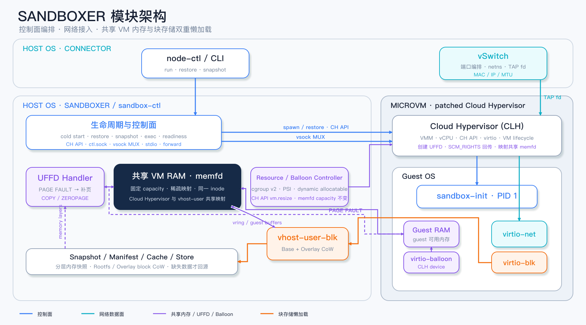
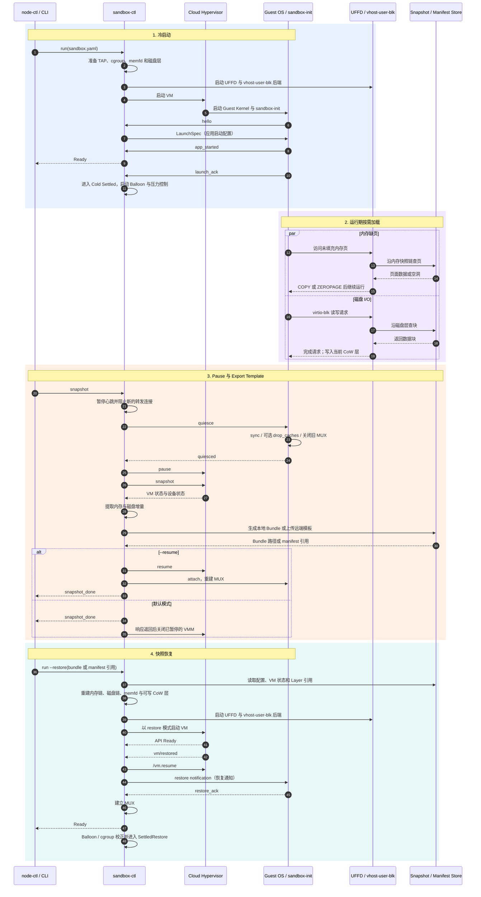
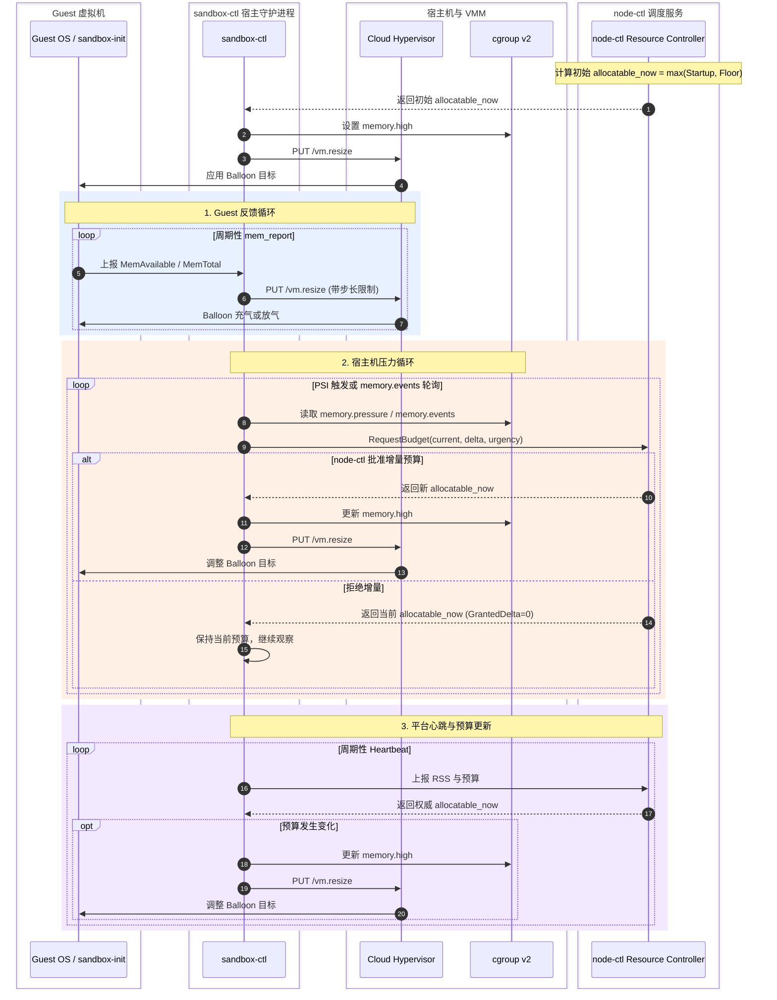
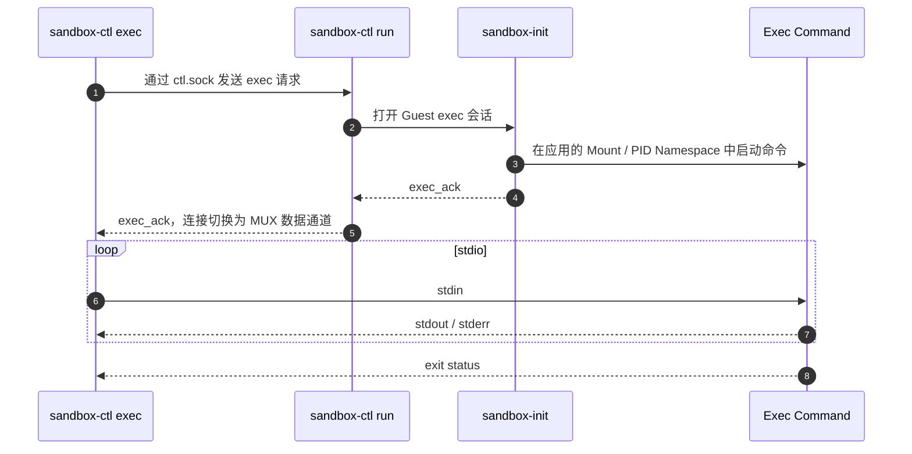
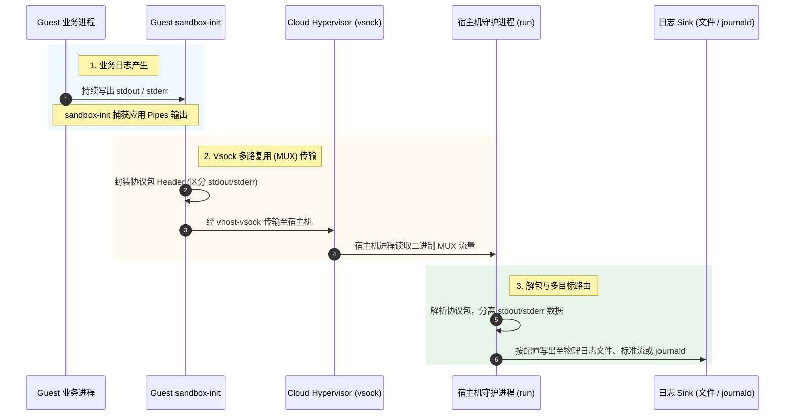

# Sandboxer 核心设计概览

## 一、Sandboxer 核心概念与设计思想

### 1.1 背景与核心痛点

传统轻量级虚拟机在快照恢复与高密部署下主要面临两大核心痛点：

1. **启动与恢复耗时线性增长**：缺乏按需加载机制时，系统需预先全量装载 rootfs 镜像与内存快照，导致容器拉起耗时与本地存储开销随工件体积线性膨胀。
2. **Guest 内存感知黑盒与动态回收难题**：Guest 操作系统独立管理其逻辑物理地址空间，宿主机侧无法直接感知或回收虚机内部的空闲物理页，极大限制了单机纳管密度与物理内存超分能力。

### 1.2 核心思想

针对上述痛点，Sandboxer 提出了两条核心机制：

- **按需懒加载（Lazy Load）**：仅在发生内存缺页或磁盘读未命中时按需拉取数据。
- **动态内存超分（Dynamic Overcommit）**：通过 Guest OS 与 Host OS 协同，在运行期根据实际情况按需调节物理内存占用。

### 1.3 设计目标

1. **按需懒加载**：恢复与启动阶段无需预装载全量内存快照与 rootfs 镜像，按需拉取数据，大幅降低拉起耗时与存储开销。
2. **分层快照**：仅保存增量数据与稀疏工作集，通过父子快照引用完成完整状态重构，最大化减少物理存储空间。
3. **高效共享内存**：建立统一的内存共享平面，支持多组件对虚机内存物理映射的高效协同访问。
4. **弹性高密部署**：结合宿主机与虚机内部的动态压力感知，实现平滑、安全的物理内存超分与资源回收。

### 1.4 四项内核与虚拟化能力分工

为达成上述设计目标，Sandboxer 整合了四项 Linux 内核与底层虚拟化能力：

| 内核能力 / 组件 | 作用对象 | 功能定位 | 核心工作机制 |
| :--- | :--- | :--- | :--- |
| **External UFFD** | Guest 内存缺页 | **外置内存数据面** | 由 patched Cloud Hypervisor 创建并移交 UFFD fd；Sandboxer 外置 Handler 捕获缺页事件，沿内存链查找源数据，通过 `UFFDIO_COPY` 填充页面或以 `UFFDIO_ZEROPAGE` 完成补零。 |
| **vhost-user-blk** | Guest 磁盘 I/O | **用户态块设备后端** | 在用户态处理 VirtIO 块请求，按“当前可写 CoW 层 → 磁盘链”递归按需读写。 |
| **Balloon 设备** | Guest 内部物理页 | **Guest 内存弹性调节器** | 充气时占用 Guest 内部物理页并归还 Host；放气时将物理页归还 Guest OS，动态扩展可用内存。 |
| **Cgroup v2** | Host 物理内存 | **Host 侧资源安全防线** | 利用 PSI 压力监控与 `memory.high / memory.max` 水位限制，对突发物理分配施加内核级节流与安全红线防御。 |

**协同关系总览**：**UFFD 负责内存“按需填充”，vhost-user-blk 负责磁盘“按需读写”，Balloon 负责 Guest 内部“动态收放”，Cgroup v2 负责 Host 外部“软水位节流与硬上限保护”。**

> [!NOTE]
> **关于外置 UFFD 协作机制**：
> 这里的 UFFD 是 Sandboxer 挂接到 Cloud Hypervisor Guest RAM 上的**外置数据面**。Cloud Hypervisor 负责构建 Guest 物理内存映射并触发内核缺页事件，Sandboxer 负责页面来源判决、远端读取、校验、解密与回填。两者通过 UFFD 文件描述符与共享 `memfd` 实现高效率的数据面解耦协作。


---

## 二、Sandboxer 架构图



这张图可以从五条主线理解：

1. **控制面**：`sandbox-ctl` 承载 `run`、`restore`、`pause`、`snapshot`、`exec` 和健康检查，管理 Cloud Hypervisor 及其配套后端的生命周期。
2. **内存数据面**：Guest RAM 基于共享 `memfd` 建立；恢复后访问未填充页面时，由 UFFD Handler 从内存快照层中按需读取并填充。
3. **磁盘数据面**：Guest 的块设备请求进入 vhost-user-blk 后端，由 CoW 块设备按“当前可写层 → 快照层 → 历史层 → rootfs base”的顺序完成读写。
4. **资源控制面**：BalloonController 结合 Guest 内存上报、宿主机 cgroup 压力和平台预算动态调整虚拟机内存。
5. **网络数据面**：沙箱网络通过宿主机的 TAP 虚拟网卡设备接入 vSwitch 进行网络流量转发。

`sandbox-ctl` 是宿主机侧的核心控制中枢，统筹维护沙箱生命周期，并连接 UFFD、vhost-user-blk、资源控制与 Guest 通信通道。

---

## 三、全生命周期：冷启动 → Pause → Export Template → 快照恢复




---

## 四、高密部署：基于 Balloon 与 Cgroup v2 的联合控制架构

高密部署的核心在于通过动态内存调配提升单机 VM 密度。VM 维持较大 Guest 规格（`capacity`），但 Host 侧仅承诺当前实际允许使用的内存预算（`allocatable_now`），并通过 **Guest 侧 Balloon**、**Host 侧 cgroup v2** 与 **平台调度器（node-ctl）** 协同构建控制闭环。

### 4.1 核心控制机制

#### 1. Balloon 设备（Guest 侧）
根据物理配额调节可用内存：
- **算式**：`balloon_target ≈ capacity - allocatable_now`
- **机制**：**充气（Inflate）** 强迫 Guest 回收空闲物理页；**放气（Deflate）** 释放内存应对业务高峰。

#### 2. cgroup v2 水位线（Host 侧）
- **`memory.high`（软限制）**：初始设为 `allocatable * 0.875`，跟随 `allocatable_now` 动态同比例更新。触及后触发内核主动回收与分配节流（Throttling），作为平抑突发分配的缓冲线。
- **`memory.max`（硬限制）**：计算为 `capacity + overhead`，不可逾越的安全红线，物理用量超限且回收失败则触发 cgroup OOM。

```text
Balloon 设备 (Guest 内) ==> 主动收缩/释放 Guest 内部空闲物理页
memory.high (Host 外) ==> 宿主机软限制，触发内核节流与预算申请
memory.max  (Host 外) ==> 宿主机硬限制，守住全局物理安全红线
```

### 4.2 三层联动控制逻辑

控制机制由三条异步并行路径协同驱动：
1. **Guest 反馈环**：基于周期性 `mem_report` 上报微调 Balloon 目标（不改变 `allocatable_now`）。
2. **Host 压力环**：感知 PSI / `memory.events` 后向 `node-ctl` 申请追加配额；若获批则同步更新 `memory.high` 与 Balloon。
3. **平台心跳环**：`node-ctl` 通过 Heartbeat 评估全局算力并更新权威 `allocatable_now`。



### 4.3 突发高内存降级防线

```text
Guest 业务突发物理内存申请
    ↓
宿主机 cgroup 物理用量上升触及 memory.high
    ↓
内核施加节流（Throttling）并产生 PSI / memory.events(high) 信号
    ↓
SCT 调用 RequestBudget 向 node-ctl 申请追加 allocatable_now 配额
    ├── 批准：提升 memory.high，Balloon 放气供用
    └── 拒绝 / 已达 memory.max：保持节流，回收失败触发 cgroup OOM
```

---

## 五、Exec 实现与应用日志

### 5.1 Exec 链路

`sandbox-ctl exec` 不会启动新的 VM，而是在已有沙箱中创建一条独立命令会话：



Exec 会话在 Guest 内创建独立的兄弟进程，并共享主应用的 Mount 与 PID Namespace。`sandbox-ctl run` 完成握手后在宿主机 `ctl.sock` 与 MUX 通道间透明转发字节流，并将退出状态透传回 CLI。

### 5.2 应用日志

主应用的 `stdout` 和 `stderr` 也依托 Guest 与宿主机之间的 MUX 通道穿透透传：



MUX 协议包 Header 精准标识流量类型（stdin/stdout/stderr/exit code）；宿主机侧守护进程解包后，按路由配置重定向输出至目标日志 Sink。
> [!NOTE]
> Cloud Hypervisor 自身的控制台输出日志（Console Log）与 Guest 业务应用的 stdio 走的是完全两条独立的通道，互不干扰。

---

## 六、总结

| 核心问题                     | Sandboxer 机制                                                          |
| ---------------------------- | ----------------------------------------------------------------------- |
| 恢复前需要装载全部内存       | UFFD 按页处理缺页，并沿增量内存层查找数据。                             |
| 启动前需要下载全部 rootfs    | vhost-user-blk 按块读取，并通过 CoW 层隔离运行期写入。                  |
| 每次快照重复保存完整状态     | 内存 `from_refs` 与磁盘 overlay 链复用历史数据。                        |
| Guest 空闲内存难以回收       | Balloon 根据 Guest、cgroup 与平台预算动态调整可用内存。                 |
| 高密部署缺少明确资源边界     | `capacity`、`allocatable_now`、`memory.high` 与 `memory.max` 分层控制。 |
| 运行中需要执行命令和采集日志 | `ctl.sock`、Guest 会话与 MUX 连接 Exec、stdio 和退出状态。              |

Sandboxer 的核心设计可归纳为：以“按需装载”替代“全量准备”，以“分层复用”替代“完整复制”，并利用 Balloon 与 cgroup 将 Guest 内存纳入统一的动态资源调控闭环。
